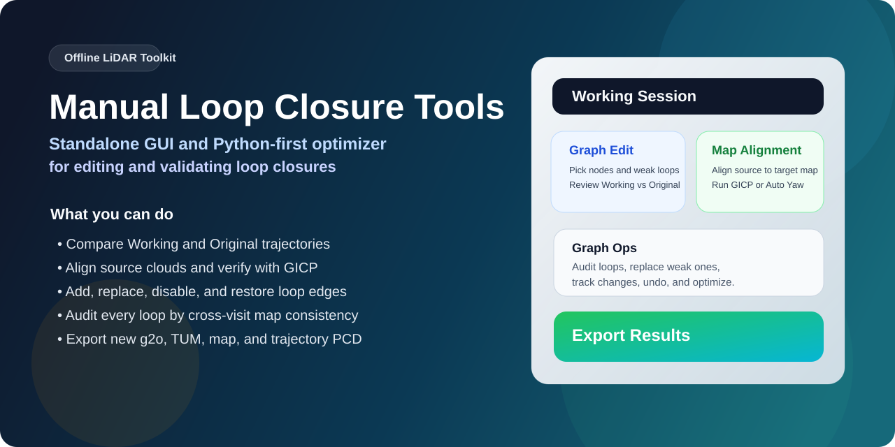
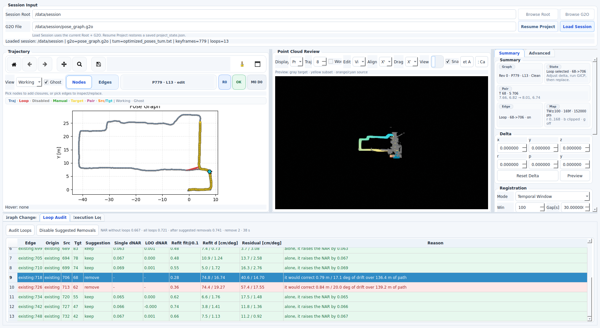
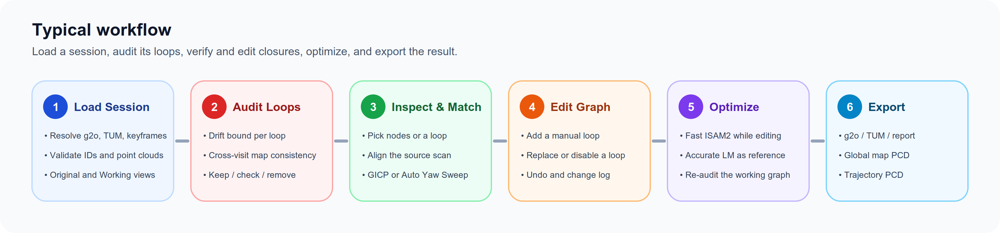
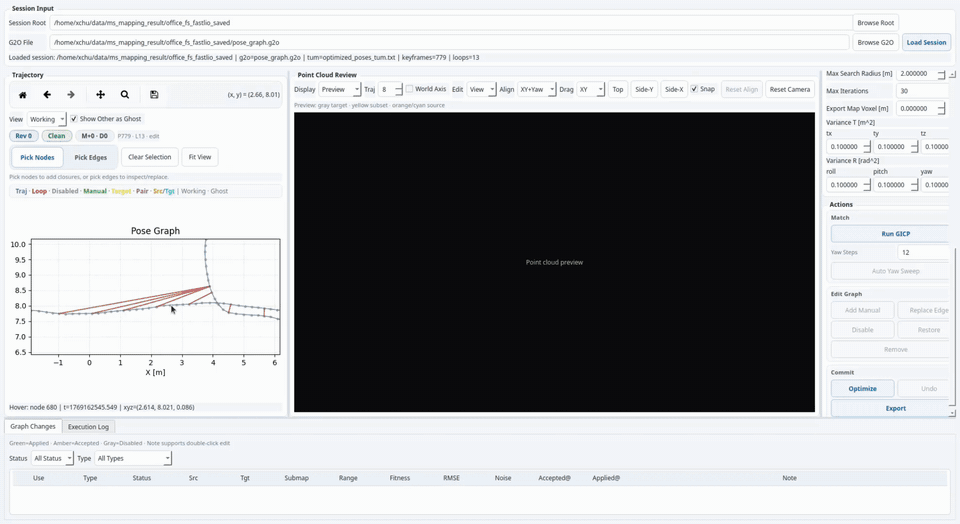
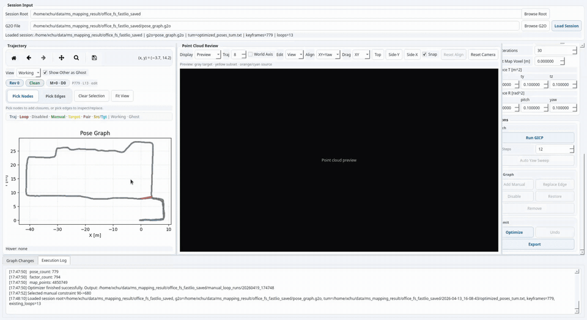
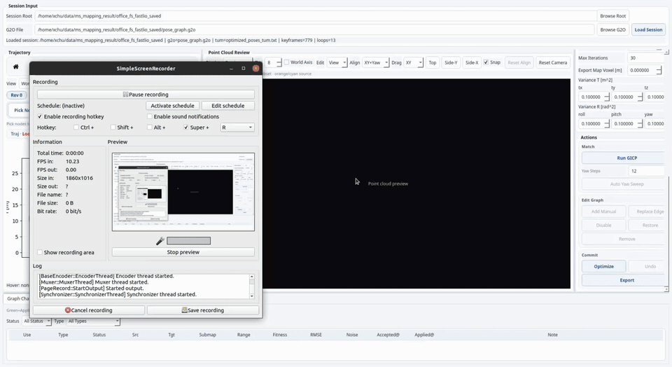

<div align="center">

<h1>Manual Loop Closure Tools</h1>

<p><a href="README.md"><b>English</b></a> | <a href="README.zh.md">中文</a></p>

<p><a href="https://github.com/JokerJohn"><b>Xiangcheng Hu</b></a>, <a href="https://github.com/zarathustr">Jin Wu</a>, <a href="https://github.com/Chen-Xieyuanli">Xieyuanli Chen</a></p>



<a href="https://github.com/JokerJohn/Mannual-Loop-Closure-Tools/actions/workflows/ci.yml"></a><a href="https://youtu.be/lemd4XfPSYY"></a><a href="https://www.bilibili.com/video/BV1B6R4BGEvo/"></a><a href="./LICENSE"></a><a></a>[](https://github.com/JokerJohn/Mannual-Loop-Closure-Tools/stargazers)<a href="https://github.com/JokerJohn/Mannual-Loop-Closure-Tools/network/members"></a>[](https://github.com/JokerJohn/Mannual-Loop-Closure-Tools/issues)

</div>

## Introduction

A single wrong loop closure folds a LiDAR map, and a missed loop leaves its drift uncorrected; both are usually found only after mapping, when the online system is no longer running. **Manual Loop Closure Tools** opens an archived pose graph with its keyframe scans, audits every loop, and lets the operator verify, add, replace or disable loops before the graph is optimized and exported again, without ROS.

**Key insight: a loop is judged by the map it produces, not by its noise model.** Two visits of the same surface agree in their surface normals, whereas a map folded by a wrong loop overlays different structures. The agreement of cross-visit overlaps therefore scores each loop without a reference trajectory.

- **Verified loop editing.** A loop is added or replaced only after the source scan is registered to a target submap, with an automatic yaw sweep for reversed revisits.
- **Loop audit.** Every active loop is checked against a drift bound and scored by map consistency and repeated registration, with a keep, check or remove suggestion.
- **ROS-free optimization and export.** A Python GTSAM backend re-solves the edited graph and exports `g2o`, TUM, the global map and the trajectory, with resumable edit projects.

|  |  |
| ------------------------------------------------------------ | ------------------------------------------------------------ |

## News

- **2026/11/01**: Loop Audit tab, overlap-ranked yaw sweep, and two fixes of the edge weights read from and written to `g2o` files (see [Changelog](CHANGELOG.md)). Sessions optimized with earlier versions should be optimized again.
- **2026/04/18**: First standalone release of the GUI and the Python optimizer.

## Video

<div align="center">

<a href="https://youtu.be/lemd4XfPSYY"></a>

</div>

Click the image to play the tutorial video ([Bilibili](https://www.bilibili.com/video/BV1B6R4BGEvo/)).

## Method

<div align="center">



</div>

**Verified loop editing.** The operator picks two keyframes or an existing loop, aligns the source scan in the point-cloud view, and accepts the GICP result as a new or replacing loop. The yaw sweep refines every seed at 0.5 m and 0.2 m and ranks the seeds by their overlap at 0.1 m.

|  |  |
| ------------------------------------------------------------ | ------------------------------------------------------------ |

**Loop audit, stage 1.** A loop is implausible when it corrects more drift than a LiDAR-inertial front end accumulates over the path length $L_{ij}$ between its keyframes:

<div align="center">

$$
\lVert \Delta\mathbf{t}_{ij} \rVert > 0.5\,\mathrm{m} + 0.05\,L_{ij} \qquad \text{or} \qquad \lVert \Delta\boldsymbol{\theta}_{ij} \rVert > 2^{\circ} + 0.1^{\circ}\mathrm{/m} \cdot L_{ij}
$$

</div>

Each remaining loop is then added alone to the graph without loops and kept only if it raises the normal agreement ratio of the stitched map, the fraction of cross-visit overlaps $\mathcal{O}$ whose normals agree within 25°:

<div align="center">

$$
\mathrm{NAR} = \frac{1}{|\mathcal{O}|} \sum_{(p,q) \in \mathcal{O}} \left[\, \angle(\mathbf{n}_p, \mathbf{n}_q) < 25^{\circ} \,\right]
$$

</div>

**Loop audit, stage 2.** A greedy leave-one-out removes the loops that pass alone but conflict with the others, and a coarse-to-fine re-registration (1.0, 0.3, 0.1 m) marks measurements that do not reproduce. The suggested removals are disabled in one undoable step; on the sample session the audit flags the two loops 706→68 and 713→62, which would correct 17.1° and 20.0° of rotation drift.

|  |  |
| ------------------------------------------------------------ | ------------------------------------------------------------ |

**Optimization and export.** `Fast ISAM2` updates the working graph after each edit and `Accurate LM` gives the batch reference solve. The default loop noise is 5 cm and 0.3°. `Export` rebuilds the global map only once, for the selected run.

## Getting Started

Tested on Ubuntu 20.04 with Python 3.10, Open3D 0.19.0, PyQt5 5.15.10 and GTSAM 4.3; ROS and the legacy C++ optimizer are optional.

```bash
git clone https://github.com/JokerJohn/Mannual-Loop-Closure-Tools.git
cd Mannual-Loop-Closure-Tools
make venv && source .venv/bin/activate
make gtsam-python                     # Python GTSAM 4.3 wrapper
python launch_gui.py --session-root /path/to/mapping_session
```

A session contains `pose_graph.g2o`, `optimized_poses_tum.txt` and `key_point_frame/*.pcd`; `--g2o /path/to/pose_graph.g2o` opens a graph directly. A [sample session](https://drive.google.com/file/d/1iu3wO5YsiIl9ZuWlSlXz2fmu6ujTBw5J/view?usp=drive_link) is available for a first test. Docker and conda paths are described in [docs/DOCKER.md](docs/DOCKER.md) and [docs/INSTALL.md](docs/INSTALL.md).

```bash
make docker-build && xhost +local:docker
docker run --rm -it --net=host -e DISPLAY=$DISPLAY -e QT_X11_NO_MITSHM=1 \
  -v /tmp/.X11-unix:/tmp/.X11-unix:rw -v /path/to/mapping_session:/data/session \
  manual-loop-closure-tools:latest python launch_gui.py --session-root /data/session
```

The audit and the optimizer also run headless:

```bash
cd gui && python -m manual_loop_closure.loop_audit --session-root /path/to/mapping_session --output audit.json
python gui/manual_loop_closure/python_optimizer/cli.py --help
make test                             # unit tests, including the g2o information order
```

<details>
<summary><b>Output files</b></summary>

| Location | Purpose | Main files |
|---|---|---|
| `manual_loop_projects/<project_id>/` | Edit project for resume and review | `project_state.json`, `execution.log`, `operations.jsonl`, `loop_audit_*.json` |
| `manual_loop_runs/<run_id>/` | One optimization run | `pose_graph.g2o`, `optimized_poses_tum.txt`, `manual_loop_constraints.csv`, `manual_loop_report.json` |
| `manual_loop_exports/<export_id>/` | Final export pointer | `export_manifest.json`, `selected_run.txt`, `run` symlink |

`Load Session` resumes the latest project of a session root, and `Resume Project` restores a selected `project_state.json`.

</details>

<details>
<summary><b>Python and C++ backend parity</b></summary>

| Session | Constraints | Python [s] | C++ [s] | TUM max t err [m] | TUM max r err [rad] | Map points Py / C++ |
|---|---:|---:|---:|---:|---:|---:|
| `office_fs_fastlio_saved` | 1 | 10.193 | 2.096 | 5.20e-09 | 3.11e-06 | 4,850,749 / 4,850,749 |
| `floor34-1_fs_fastlio_saved` | 1 | 16.335 | 3.827 | 1.00e-09 | 3.56e-06 | 13,771,605 / 13,771,605 |
| `dr_tunnel_2026_01_24_145439` | 0 | 12.112 | 2.909 | 2.49e-08 | 2.87e-09 | 2,139,789 / 2,139,789 |

The Python backend is the default; the C++ backend in `backend/catkin_ws` is kept as a parity reference and is built with `make backend`.

</details>

Further documentation: [Tool Manual](docs/TOOL_README.md), [Python GTSAM 4.3](docs/INSTALL_GTSAM_PYTHON.md), [Wiki](https://github.com/JokerJohn/Mannual-Loop-Closure-Tools/wiki), [Contributing](CONTRIBUTING.md).

## TODO

- [x] Standalone GUI, Python optimizer, Docker image
- [x] Loop audit with keep, check and remove suggestions
- [ ] Wiki page for the loop audit

## Citation

This tool is derived from the [MS-Mapping](https://github.com/JokerJohn/MS-Mapping) codebase. If it helps your work, please cite:

```bibtex
@article{hu2024msmapping,
  title         = {MS-Mapping: An Uncertainty-Aware Large-Scale Multi-Session LiDAR Mapping System},
  author        = {Hu, Xiangcheng and Wu, Jin and Jiao, Jianhao and Jiang, Binqian and Zhang, Wei and Wang, Wenshuo and Tan, Ping},
  journal       = {arXiv preprint arXiv:2408.03723},
  eprint        = {2408.03723},
  archivePrefix = {arXiv},
  primaryClass  = {cs.RO},
  year          = {2024}
}
```

Related work: [MS-Mapping](https://github.com/JokerJohn/MS-Mapping) and [PALoc](https://github.com/JokerJohn/PALoc).

## Acknowledgment

The tool is built on [GTSAM](https://github.com/borglab/gtsam), [Open3D](https://github.com/isl-org/Open3D) and PyQt5. The sample session was recorded with [FAST-LIO](https://github.com/hku-mars/FAST_LIO) as the front end.

## License

Released under the [GNU General Public License v3.0](LICENSE).

## Contributors

<a href="https://github.com/JokerJohn/Mannual-Loop-Closure-Tools/graphs/contributors">
  
</a>
