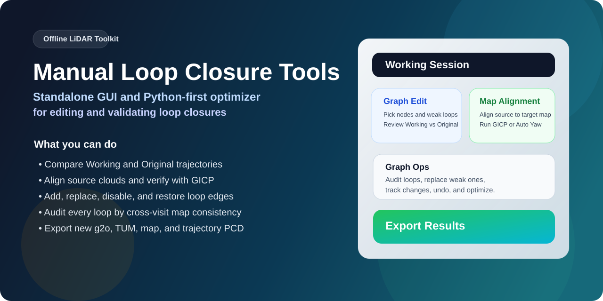
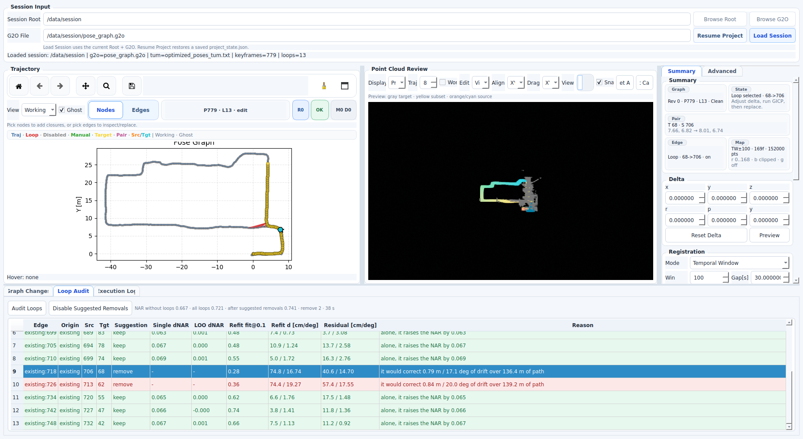
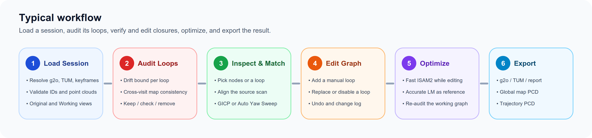
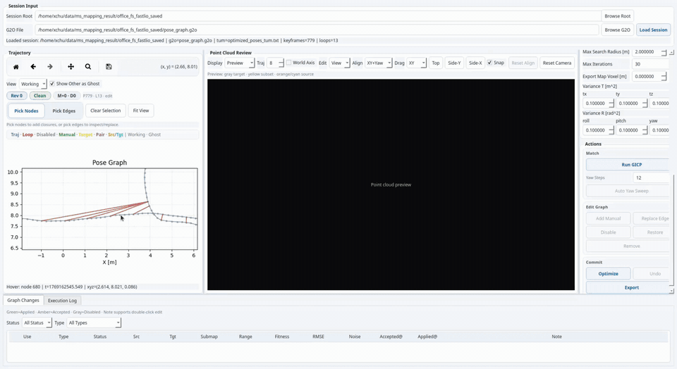
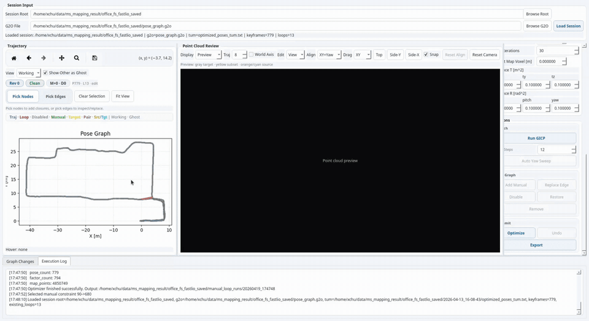
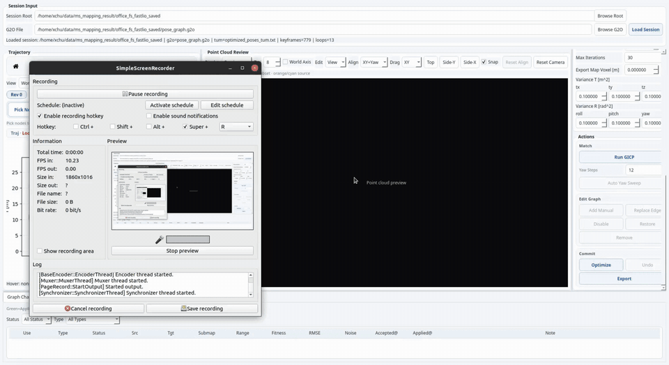

<div align="center">

<h1>Manual Loop Closure Tools</h1>

<p><a href="README.md">English</a> | <a href="README.zh.md"><b>中文</b></a></p>

<p><a href="https://github.com/JokerJohn"><b>Xiangcheng Hu</b></a>, <a href="https://github.com/zarathustr">Jin Wu</a>, <a href="https://github.com/Chen-Xieyuanli">Xieyuanli Chen</a></p>



<a href="https://github.com/JokerJohn/Mannual-Loop-Closure-Tools/actions/workflows/ci.yml"></a><a href="https://youtu.be/lemd4XfPSYY"></a><a href="https://www.bilibili.com/video/BV1B6R4BGEvo/"></a><a href="./LICENSE"></a><a></a>[](https://github.com/JokerJohn/Mannual-Loop-Closure-Tools/stargazers)<a href="https://github.com/JokerJohn/Mannual-Loop-Closure-Tools/network/members"></a>[](https://github.com/JokerJohn/Mannual-Loop-Closure-Tools/issues)

</div>

## 简介

一条错误的闭环会使 LiDAR 地图折叠，一条缺失的闭环则使漂移得不到校正；二者通常在建图结束、在线系统已停止之后才被发现。**Manual Loop Closure Tools** 读取已归档的位姿图及其关键帧点云，审计每一条闭环，并支持操作者在重新优化与导出之前验证、新增、替换或禁用闭环，全程无需 ROS。

**核心思想：闭环由其生成的地图评判，而非由其噪声模型评判。** 同一表面的两次访问在表面法向上一致，而被错误闭环折叠的地图会叠加不同的结构。因此，跨访问重叠区域的法向一致性可以在没有参考轨迹的情况下为每条闭环打分。

- **经验证的闭环编辑。** 仅当源点云与目标子图配准成功后才新增或替换闭环；对反向重访提供自动 yaw 搜索。
- **闭环审计。** 每条有效闭环先经漂移界检验，再由地图一致性与重复配准打分，并给出保留、检查、移除或冗余建议。
- **无 ROS 的优化与导出。** Python GTSAM 后端重新求解编辑后的位姿图，导出 `g2o`、TUM、全局地图与轨迹，并支持可恢复的编辑工程。

|  |  |
| ------------------------------------------------------------ | ------------------------------------------------------------ |

## 更新

- **2026/11/01**：新增 Loop Audit 页面与按重叠率排序的 yaw 搜索，修复 `g2o` 文件读写中边权重的两处错误（见 [Changelog](CHANGELOG.md)）。由早期版本优化过的会话应重新优化。
- **2026/04/18**：首次发布独立的 GUI 与 Python 优化器。

## 视频

<div align="center">

<a href="https://youtu.be/lemd4XfPSYY"></a>

</div>

点击图片播放教程视频（[Bilibili](https://www.bilibili.com/video/BV1B6R4BGEvo/)）。

## 方法

<div align="center">



</div>

**经验证的闭环编辑。** 操作者选取两个关键帧或一条已有闭环，在点云视图中对齐源点云，并将 GICP 结果作为新增或替换闭环接受。yaw 搜索对每个初值依次在 0.5 m 与 0.2 m 下精配准，并按 0.1 m 下的重叠率排序。默认闭环噪声为 5 cm 与 0.3°。

|  |  |
| ------------------------------------------------------------ | ------------------------------------------------------------ |

**闭环审计，第一阶段。** 若一条闭环所校正的漂移超过 LiDAR-惯性前端在其两关键帧之间路径长度 $L_{ij}$ 上可能累积的漂移，则判为不可信：

<div align="center">

$$
\lVert \Delta\mathbf{t}_{ij} \rVert > 0.5\,\mathrm{m} + 0.05\,L_{ij} \qquad \text{or} \qquad \lVert \Delta\boldsymbol{\theta}_{ij} \rVert > 2^{\circ} + 0.1^{\circ}\mathrm{/m} \cdot L_{ij}
$$

</div>

在示例会话上，漂移界标记了 706→68 与 713→62 两条闭环（源→目标），它们将分别校正 17.1° 与 20.0° 的旋转漂移。其余每条闭环单独加入无闭环的位姿图：降低拼接地图法向一致率（NAR）的闭环建议移除，提高 NAR 的闭环保留，无可测影响的闭环标记为冗余。NAR 即跨访问重叠集合 $\mathcal{O}$ 中法向夹角小于 25° 的比例：

<div align="center">

$$
\mathrm{NAR} = \frac{1}{|\mathcal{O}|} \sum_{(p,q) \in \mathcal{O}} \left[\, \angle(\mathbf{n}_p, \mathbf{n}_q) < 25^{\circ} \,\right]
$$

</div>

**闭环审计，第二阶段。** 贪心留一法移除单独通过、但与其他闭环冲突的闭环；由粗到精的重配准（1.0、0.3、0.1 m）标记无法复现的测量。建议移除的闭环可一步禁用并可撤销。

|  |  |
| ------------------------------------------------------------ | ------------------------------------------------------------ |

**优化与导出。** `Fast ISAM2` 在每次编辑后更新工作位姿图，`Accurate LM` 提供批量参考解。`Export` 仅对选定的运行结果重建一次全局地图。

## 快速开始

测试环境为 Ubuntu 20.04、Python 3.10、Open3D 0.19.0、PyQt5 5.15.10 与 GTSAM 4.3；ROS 与旧版 C++ 优化器为可选项。

```bash
git clone https://github.com/JokerJohn/Mannual-Loop-Closure-Tools.git
cd Mannual-Loop-Closure-Tools
make venv && source .venv/bin/activate
make gtsam-python                     # Python GTSAM 4.3 wrapper
python launch_gui.py --session-root /path/to/mapping_session
```

会话目录包含 `pose_graph.g2o`、`optimized_poses_tum.txt` 与 `key_point_frame/*.pcd`；`--g2o /path/to/pose_graph.g2o` 可直接打开位姿图。可下载[示例会话](https://drive.google.com/file/d/1iu3wO5YsiIl9ZuWlSlXz2fmu6ujTBw5J/view?usp=drive_link)进行首次测试。Docker 与 conda 方式见 [docs/DOCKER.md](docs/DOCKER.md) 与 [docs/INSTALL.md](docs/INSTALL.md)。

```bash
make docker-build && xhost +local:docker
docker run --rm -it --net=host -e DISPLAY=$DISPLAY -e QT_X11_NO_MITSHM=1 \
  -v /tmp/.X11-unix:/tmp/.X11-unix:rw -v /path/to/mapping_session:/data/session \
  manual-loop-closure-tools:latest python launch_gui.py --session-root /data/session
```

审计与优化器也可无界面运行：

```bash
cd gui && python -m manual_loop_closure.loop_audit --session-root /path/to/mapping_session --output audit.json
python gui/manual_loop_closure/python_optimizer/cli.py --help
make test                             # unit tests, including the g2o information order
```

<details>
<summary><b>输出文件</b></summary>

| 位置 | 用途 | 主要文件 |
|---|---|---|
| `manual_loop_projects/<project_id>/` | 用于恢复与复查的编辑工程 | `project_state.json`、`execution.log`、`operations.jsonl`、`loop_audit_*.json` |
| `manual_loop_runs/<run_id>/` | 一次优化运行 | `pose_graph.g2o`、`optimized_poses_tum.txt`、`manual_loop_constraints.csv`、`manual_loop_report.json` |
| `manual_loop_exports/<export_id>/` | 最终导出指针 | `export_manifest.json`、`selected_run.txt`、`run` 符号链接 |

`Load Session` 恢复该会话根目录下最近的工程，`Resume Project` 恢复选定的 `project_state.json`。

</details>

<details>
<summary><b>Python 与 C++ 后端一致性</b></summary>

| 会话 | 约束数 | Python [s] | C++ [s] | TUM 最大平移误差 [m] | TUM 最大旋转误差 [rad] | 地图点数 Py / C++ |
|---|---:|---:|---:|---:|---:|---:|
| `office_fs_fastlio_saved` | 1 | 10.193 | 2.096 | 5.20e-09 | 3.11e-06 | 4,850,749 / 4,850,749 |
| `floor34-1_fs_fastlio_saved` | 1 | 16.335 | 3.827 | 1.00e-09 | 3.56e-06 | 13,771,605 / 13,771,605 |
| `dr_tunnel_2026_01_24_145439` | 0 | 12.112 | 2.909 | 2.49e-08 | 2.87e-09 | 2,139,789 / 2,139,789 |

默认使用 Python 后端；`backend/catkin_ws` 中的 C++ 后端作为一致性参考保留，可通过 `make backend` 编译。

</details>

更多文档：[工具手册](docs/TOOL_README.md)、[Python GTSAM 4.3](docs/INSTALL_GTSAM_PYTHON.md)、[Wiki](https://github.com/JokerJohn/Mannual-Loop-Closure-Tools/wiki)、[贡献指南](CONTRIBUTING.md)。

## TODO

- [x] 独立 GUI、Python 优化器、Docker 镜像
- [x] 带保留、检查、移除与冗余建议的闭环审计
- [ ] 闭环审计的 Wiki 页面

## 引用

本工具源自 [MS-Mapping](https://github.com/JokerJohn/MS-Mapping) 代码库。如对您的工作有帮助，请引用：

```bibtex
@article{hu2024msmapping,
  title         = {MS-Mapping: An Uncertainty-Aware Large-Scale Multi-Session LiDAR Mapping System},
  author        = {Hu, Xiangcheng and Wu, Jin and Jiao, Jianhao and Jiang, Binqian and Zhang, Wei and Wang, Wenshuo and Tan, Ping},
  journal       = {arXiv preprint arXiv:2408.03723},
  eprint        = {2408.03723},
  archivePrefix = {arXiv},
  primaryClass  = {cs.RO},
  year          = {2024}
}
```

相关工作：[MS-Mapping](https://github.com/JokerJohn/MS-Mapping) 与 [PALoc](https://github.com/JokerJohn/PALoc)。

## 致谢

本工具基于 [GTSAM](https://github.com/borglab/gtsam)、[Open3D](https://github.com/isl-org/Open3D) 与 PyQt5 构建。示例会话以 [FAST-LIO](https://github.com/hku-mars/FAST_LIO) 作为前端录制。

## 许可

以 [GNU General Public License v3.0](LICENSE) 发布。

## 贡献者

<a href="https://github.com/JokerJohn/Mannual-Loop-Closure-Tools/graphs/contributors">
  
</a>
